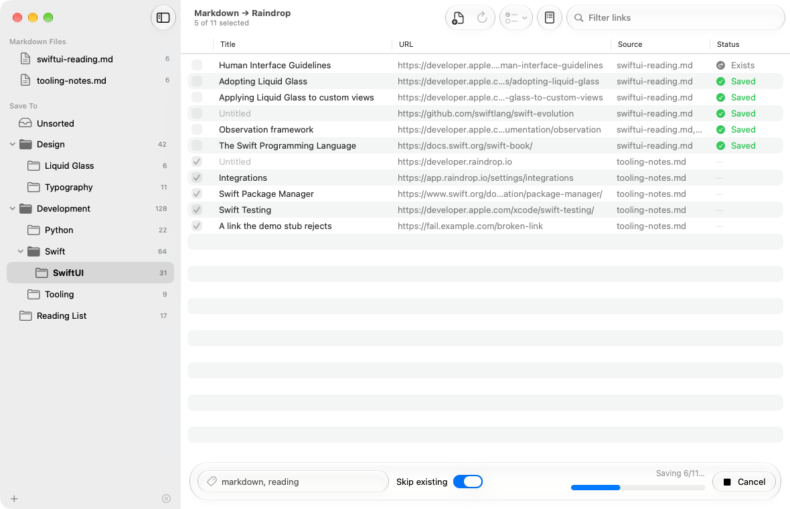

# Toolbelt

A collection of Python automation tools for personal productivity and content management.

## Scripts

| Script | Description |
| --- | --- |
| [`bookmarks_github.py`](bookmarks_github.py) | Clone GitHub repos bookmarked in Raindrop.io (CLI). |
| [`md_to_raindrop.py`](md_to_raindrop.py) | GUI to extract links from Markdown files and save them as Raindrop.io bookmarks. |
| [`macos/MarkdownToRaindrop/build-app.sh`](macos/MarkdownToRaindrop/build-app.sh) | Build (or test) the native macOS SwiftUI version of Markdown → Raindrop.io. |
| [`medium_bookmarks.py`](medium_bookmarks.py) | Export Medium bookmarks from a Raindrop.io collection to CSV. |
| [`run.py`](run.py) | Run the Medium Daily Digest Agent. |
| [`setup_schedule.py`](setup_schedule.py) | Install/remove a macOS launchd schedule for the Medium digest. |

## Tools

### 1. Raindrop GitHub Sync (`raindrop-github-sync`)

Syncs GitHub repositories from your Raindrop.io bookmark collections to a local directory.

**Features:**
- Fetches bookmarks from **all collections** or a specific Raindrop.io collection via API
- Automatically identifies and filters GitHub repository URLs from bookmarks
- Clones repositories with shallow clone (--depth 1) for faster syncing
- Skips existing repositories to avoid duplicates
- Supports both HTTPS and SSH clone URLs
- Dry-run mode to preview actions without cloning
- URL dump mode to just list GitHub repos found

**Installation:**
```bash
cd scripts/python/automation-tools
pip install -e .
```

**Usage:**
```bash
# Set your token
export RAINDROP_TOKEN="your-token-here"

# Fetch ALL bookmarks from all collections (default behavior)
python bookmarks_github.py --dest ~/Public/GitHub

# Fetch from a specific collection only
python bookmarks_github.py --collection-id 12345 --dest ~/Public/GitHub

# Dry run to preview what would be cloned
python bookmarks_github.py --dry-run

# Use SSH clone URLs instead of HTTPS
python bookmarks_github.py --ssh

# Just dump the GitHub URLs found (no cloning)
python bookmarks_github.py --dump-urls
```

### 2. Markdown → Raindrop.io (`md_to_raindrop.py`)

A small tkinter app that pulls every link out of one or more Markdown files and saves the ones you pick as Raindrop.io bookmarks.

**Features:**
- Extracts inline (`[text](url "title")`), reference-style (`[text][id]` / `[id]: url`), autolinks (`<url>`) and bare URLs
- Skips images and anything inside code spans or fenced code blocks; ignores non-http(s) links
- Dedupes across files (case-insensitive host, trailing slash ignored) and keeps link text as the bookmark title
- Loads your collections (including nested ones) so you can pick the destination
- Tick/untick links before saving, add tags, and optionally skip URLs already in Raindrop
- Per-link progress, a log with error details, and cancel; failed links stay selected for a retry

**Usage:**
```bash
export RAINDROP_TOKEN="your-token-here"   # or paste it into the app
python md_to_raindrop.py                  # pick files in the app
python md_to_raindrop.py notes.md todo.md # or preload files
```

Requires only the standard library (on Linux, tkinter may need `sudo apt install python3-tk`). Link extraction lives in `md_links.py` and the API client in `raindrop_api.py`.

#### Native macOS app (`macos/MarkdownToRaindrop/`)

A SwiftUI version of the same tool with the current macOS look: Liquid Glass toolbar and save bar on macOS 26+ (materials on macOS 14–15), a sidebar with your files and the nested collection tree, a sortable/filterable links table, a log inspector, and light/dark mode.



- Same features as the Python GUI: pick or drag-and-drop Markdown files, tick links (click a checkbox or press Space on selected rows), add tags, skip links already in Raindrop, save with per-link progress, cancel after the current link, and **Retry Failed**.
- Link extraction and the API client are a Swift port of `md_links.py` / `raindrop_api.py` (`Sources/RaindropKit`), with the pytest suites ported to Swift Testing. No Python needed at runtime.
- The API token is stored in your login Keychain (Settings, ⌘,); if none is saved, `RAINDROP_TOKEN` is used.

**Requirements:** macOS 14+, Swift 6 (Xcode 16+ or the Command Line Tools). On macOS 26+ SDKs SwiftUI's macros ship only inside Xcode.app, so Xcode must be installed even when building with the Command Line Tools; `build-app.sh` finds it automatically.

**Build and run:**
```bash
cd macos/MarkdownToRaindrop
./build-app.sh             # → dist/Markdown to Raindrop.app (ad-hoc signed)
./build-app.sh --install   # also copy to ~/Applications
./build-app.sh --test      # run the unit tests
open "dist/Markdown to Raindrop.app" --args notes.md todo.md   # preload files
open "dist/Markdown to Raindrop.app" --args --demo Samples/*.md  # offline stub API, no token needed
```

Or open `Package.swift` in Xcode and run the `MarkdownToRaindrop` scheme. Other launch flags: `--demo-save` (with `--demo`, start a save immediately), `--appearance light|dark`, `--show-log`. `RUN_KEYCHAIN_TESTS=1 ./build-app.sh --test` also runs a Keychain round-trip test.

The app is ad-hoc signed, so after a rebuild macOS may ask once to let it read its saved Keychain item; choose **Always Allow**.

### 3. Medium Daily Digest Agent

An AI-powered agent that curates and summarizes Medium articles across your key technical interests, delivering a daily Markdown digest.

**Topics Tracked:**
- MacBooks & macOS Development
- AI Tools & Frameworks  
- Software Engineering
- DevOps & Platform Engineering
- Information Security

**Quick Start:**
```bash
export ANTHROPIC_API_KEY="sk-ant-..."
python run.py
```

See the [Medium Digest documentation](scripts/python/medium-digest-agent/README.md) for full details.

## Prerequisites

- Python 3.12 or higher
- Git installed and available in PATH
- API keys for respective services (Raindrop.io, Anthropic)

## Project Structure

```
toolbelt/
├── macos/
│   └── MarkdownToRaindrop/       # Native SwiftUI Markdown → Raindrop.io app
├── scripts/
│   └── python/
│       ├── automation-tools/     # Raindrop sync and other utilities
│       └── medium-digest-agent/  # AI article curation
├── tests/
└── README.md
```

## License

MIT
